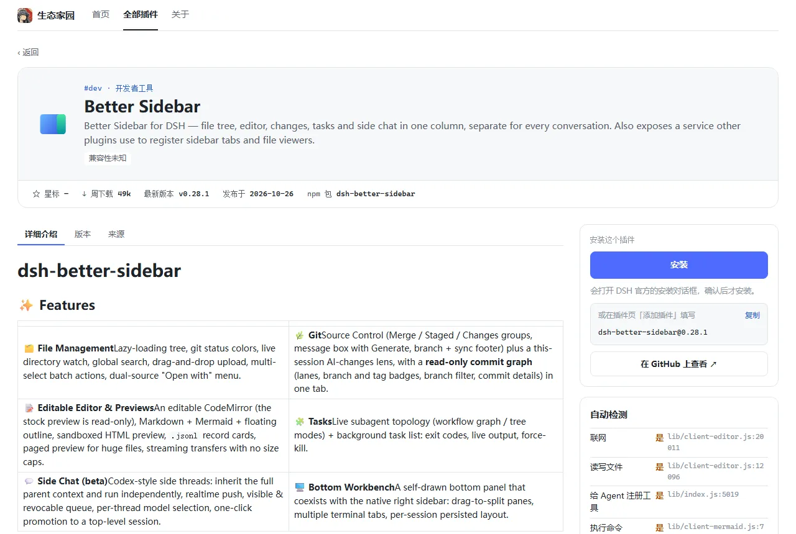

<p align="center"></p>

<h1 align="center">生态家园 · Startide</h1>

<p align="center">发现适合你自己的 <a href="https://github.com/deepseek-ai/deepseek-harness">DeepSeek Harness</a>（DSH）插件</p>

<p align="center">
  <a href="https://www.npmjs.com/package/dsh-startide"></a>
  <a href="https://github.com/yang051211/dsh-startide/blob/main/market/index.json"></a>
  <a href="https://github.com/yang051211/dsh-startide/actions/workflows/directory.yml"></a>
  <a href="https://github.com/yang051211/dsh-startide/stargazers"></a>
  <a href="LICENSE"></a>
  
</p>

<p align="center"><b>中文</b> · <a href="README.en.md">English</a></p>

---

「辰泱」：星辰下的浩瀚水面，英文名 Startide（星潮）。

生态家园是一个 DSH 插件目录。它自动收录 npm 上所有符合条件的 DSH 插件，目前约 6400 个，定时更新。你可以在 DSH 里按分类、热度、更新时间浏览这些插件，并一键安装。

> [!WARNING]
> **插件未经审核。** 它们由各自的作者发布。商店只显示「自动检测」的结果，即会不会联网、读写文件、执行命令等。这些是程序扫描源码得出的提示，可能不准，不代表安全审查。请只安装你信任的插件。

<p align="center"></p>

## 功能

- **大而全**：自动发现并收录 npm 上符合条件的 DSH 插件，不合格的自动下架。
- **好找**：首页有「本周热门」「最近更新」「新上架」；全部插件页可以按分类筛选，按热门、更新时间、上架时间、星标排序，并能隐藏与当前 DSH 不兼容的插件。
- **看得清**：每个插件都有 README、版本历史、来源链接和「自动检测」结果。
- **装得稳**：安装始终走 DSH 官方的安装对话框，确认后才装。
- **管得了**：「已安装」页列出装好的插件，标出有新版本的，确认后直接更新；也可以启用、停用、卸载，或打开它的设置。
- **一个入口**：打开「只保留生态家园」后，侧边栏只剩生态家园，插件页也不再显示官方的标题和标签栏；关掉即恢复。
- **自动更新**：目录由 GitHub Actions 定时重建，商店自己有新版本时也会提示。

| 全部插件 | 插件详情 |
|---|---|
|  |  |

## 安装

适用于 DSH 0.2.1-rc.2 至 0.2.x（不含 0.3 系列，包括其预发布版）。在 DSH 的插件页 →「添加插件」里填写包名：

```text
dsh-startide
```

- 「安装源」选「npm 官方源」或「中国大陆镜像源」都可以。**不要**设成自定义地址：设成自定义地址后，整个 profile 的依赖都会改到那个源去解析，安装会失败。
- 也可以填 GitHub 地址 `github:yang051211/dsh-startide#v<版本>`，装 GitHub 上的某个发布版本。

装好后，DSH 左侧边栏会出现「生态家园」，点它打开插件页上的「生态家园」标签。想让它成为唯一的插件入口，在「已安装」页右上角打开「只保留生态家园」。

### 从旧版升级

0.2.0 之前它叫 `dsh-plugin-store`。在旧版里点「更新」，DSH 会把新版 `dsh-startide` 装在旧版旁边；新版会提示你去插件页卸载旧版 `dsh-plugin-store`。

## 只想要插件目录？

商店读取的目录本身就是一份标准的 DSH 插件市场索引，不装本插件也能在 DSH 官方的「发现」页里使用：

1. 插件页 →「实验性插件」→「更多」→ 启用「自定义插件市场」；
2. 打开「发现」→「添加索引源」，填写：

```text
https://raw.githubusercontent.com/yang051211/dsh-startide/main/market/index.json
```

连不上 GitHub 时改用 jsDelivr 地址。注意 jsDelivr 的 `@main` 可能要过几个小时才会跟上最新目录：

```text
https://cdn.jsdelivr.net/gh/yang051211/dsh-startide@main/market/index.json
```

## 工作原理

### 收录条件

同时满足以下条件的 npm 包都会收录。不满足的自动下架，重新满足后自动回来：

1. 是 DSH 插件包（最新版的 package.json 声明了 `dsh.bundle.patch`），且没有被废弃；
2. 有源码仓库或主页；
3. `engines.dsh` 为空，或兼容 [directory/config.json](directory/config.json) 里的 `dshVersion`；
4. 最近 `recentDays`（90）天内发布过新版本。

候选包名来自 npm 搜索（`keywords` 里的关键词），并合并 `seedIndexes` 里其他目录列出的包名。npm 搜索每个查询最多只返回约 1 万条模糊结果，单靠它会漏掉一部分插件。其他目录只提供包名，是否收录仍按上面的条件看包本身。

已收录的插件每 7 天至少重新检查一次。这样即使 npm 搜索不再返回它，被删除、被废弃或不再是 DSH 插件的包也能及时下架。

### 自动检测

程序会下载每个插件的最新版本，只读取、不运行，扫描源码里的特征，标出五项：联网、读写文件、给 Agent 注册工具、执行命令、安装脚本。

- 插件包含预编译文件或压缩代码时，检测看不到这些内容，详情页会提醒「否」不代表没有。
- 新版本发布后会排队检测，完成前显示「尚未检测」。
- 包太大（压缩后超过 128 MB 或解压后超过 256 MB）或无法读取的，重试 3 次后显示「无法自动检测」，作者发布新版本后会再试。

## 开发

需要 Node.js 24（CI 使用的版本）。

```sh
npm ci
npm run build       # 构建 lib/（发布的就是提交里的 lib/，改了 src/ 要一起提交）
npm test            # 全部测试
npm run verify      # 构建 + 确认 lib/ 与 src/ 一致 + 目录校验 + 测试
```

### 发布

每个正式版同时发到 npm 和 GitHub，**先发 npm**。商店的自我更新从 npm 下载新版本的安装包，而 main 一推上去，索引里的新版本号就会让已安装的商店提示更新，所以那时 npm 上必须已经有这个版本。

1. 改 `package.json` 的 `version`，跑 `npm run verify`，提交，在本地打标签 `git tag -a v<版本>`。
2. 把标签导出到一个空目录，在那里发 npm（账号需开启两步验证）：

   ```sh
   git archive v<版本> | tar -x -C <空目录>
   cd <空目录>
   npm publish --dry-run   # 核对文件清单：只有 lib/、locale/、README、LICENSE、图标和补丁文件
   npm publish
   ```

   新包名第一次发布时，npm 会先放一个 `0.0.0-stage` 占位版本，正式版本几十秒后出现。
3. 确认 `npm view dsh-startide version` 已是新版本，再把 main 和标签一起推送：`git push --atomic origin main v<版本>`。

### 目录

目录由 [.github/workflows/directory.yml](.github/workflows/directory.yml) 定时重建，目前每 6 小时一次。也可以在本地手动跑：

```sh
npm run directory:discover   # 搜索候选包名，写入 directory/names.json（只增不减）
npm run directory:refresh    # 新包、有新版本的包、超过 7 天没查的包，重新读取包信息
npm run directory:stats      # 周下载量；按轮换刷新一部分 GitHub 星标（可设置 GITHUB_TOKEN）
npm run directory:scan       # 对还没检测的最新版本做自动检测，顺带取图标
npm run directory:build      # 生成 market/index.json、market/plugins/*.json、market/icons/
npm run directory:check      # 确认 market/ 和状态文件一致，索引能被官方读取器解析
```

单个包读取或检测失败不会中断整轮，下次运行会重试；官方读取器不接受的条目会被单独剔除并记录。`directory/config.json` 只由人编辑，工具从不写它。

设计文档在 [docs/superpowers/specs](docs/superpowers/specs/)。

## 参与贡献

- 发现某个插件有问题，或者想提建议：[开 Issue](https://github.com/yang051211/dsh-startide/issues)。
- 想改分类规则、收录条件：改 [directory/config.json](directory/config.json) 后提 Pull Request。

## 致谢

- 候选包名的补充来源：[REALOIYO/dsh-plugin-market](https://github.com/REALOIYO/dsh-plugin-market)。
- 商店图标是 AI 生成的鲸鱼女仆形象。

## 许可证

[MIT](LICENSE)
